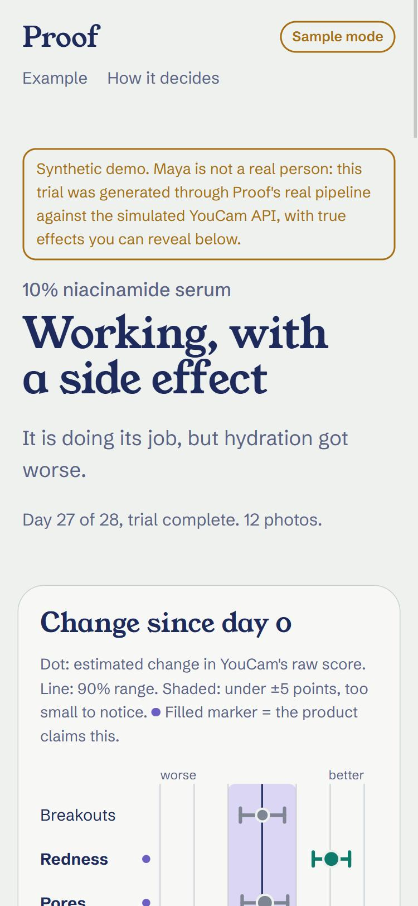
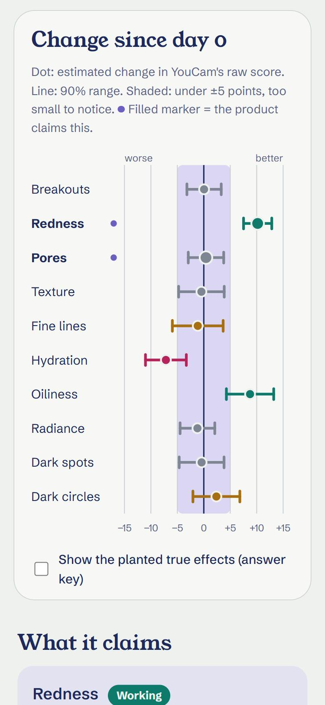
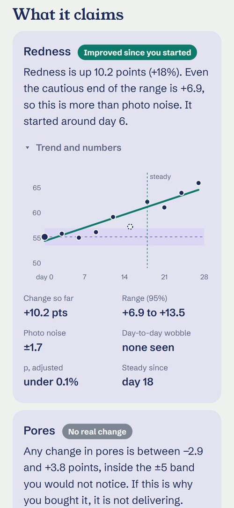
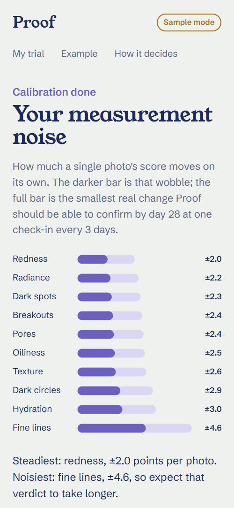

# Proof

**For anyone who has bought a skincare product and still can't tell if it works, Proof runs it like a small trial on your own face: YouCam Skin AI measures, Proof learns how noisy those measurements are for you, and at the final check-in you get a verdict with a range instead of a guess.**

<p>
  
  
  
  
</p>

- **Live demo:** `LIVE_DEMO_URL` (placeholder, see `SUBMISSION/MORNING_STEPS.md`)
- **Video (2:30):** `VIDEO_URL` (placeholder)
- **Devpost write-up:** [`SUBMISSION/devpost.md`](SUBMISSION/devpost.md)

## Why this exists

A before/after selfie compares two noisy numbers. Skin scores move a few points between two photos taken a minute apart (light, angle, expression), so with ten concerns tracked, a product that does nothing still "improves" something most of the time. In Proof's simulation of products that do nothing, a before/after comparison finds a fake improvement in at least one of ten concerns in **66%** of trials. Proof shows any improvement verdict (Improved since you started or Small improvement) in **4.7%**.

## What it does

1. **Set up.** Name the product and pick up to three things it claims to fix. Those are the pre-registered question.
2. **Calibrate.** Three selfies on day 0, a minute apart. Skin can't change in a minute, so the spread is pure measurement noise for *your* face, camera and room. Proof blends it with typical noise so three photos can't fool it.
3. **Check in** every 2-4 days. Live camera with an oval guide and quality chips (light, glare, blur, evenness), or a file upload. A check-in in different light from day 0 is flagged and counted less. Single-photo changes inside the normal wobble are shown in grey.
4. **Trend so far** until the planned final check-in. Proof gives no verdict early, because looking for one at every check-in lets luck win more often (see below).
5. **Verdict per concern** at the final check-in: Improved since you started, Small improvement, No real change, Slightly worse, Worse since you started, or Inconclusive. "No real change" is a real answer: the whole corrected range sits inside ±5 points.
6. **Share** a 1080x1350 verdict card, with a server signature on every scan so an edited result is detectable. "What to try next" lists ingredient classes for anything the product didn't fix, skipping what it already contains. Not medical advice.

A seeded synthetic trial ("Maya", a 10% niacinamide serum) is in the app under **Example**, clearly labelled. It was generated through the real pipeline against the simulated API, and its answer key (the planted true effects) can be shown on the chart.

## Built with YouCam

YouCam Skin AI is the measuring instrument. Every photo is one `skin-analysis` task with 10 SD concerns.

| What | Where |
|---|---|
| File registration, signed upload, task start, polling with backoff, 429 retry, task delete, feature-cost | [`server/youcam-client.js`](server/youcam-client.js) |
| `POST /s2s/v2.0/file` (falls back to the older `/file/skin-analysis` path on 404), `PUT` to the returned URL | `registerFile`, `uploadBytes` |
| `POST /s2s/v2.0/task/skin-analysis` with `dst_actions`, `enable_mask_overlay`, `format: "json"` | `startSkinAnalysis` |
| `GET /s2s/v2.0/task/skin-analysis/{task_id}` until `success` / `error`, engine errors mapped to plain hints | `pollSkinAnalysis`, `ENGINE_HINTS` |
| `POST /s2s/v2.0/task/delete` right after results are read (masks are inlined first) | `deleteTask`, [`server/app.js`](server/app.js) |
| `results.output[]` (the documented `format: "json"` list of `{type, ui_score, raw_score, mask_urls}`) parsed into scores and masks. HD-style nesting (`whole` plus named regions) is accepted too. If any requested concern has no score, the scan fails loudly: no scores, no signature | `normalizeSkinOutput`, `analyzeSkin` |
| Image rules checked before spending units (short side, type, size) | [`server/app.js`](server/app.js), [`server/image-info.js`](server/image-info.js) |
| Mock YouCam that replies only in the documented JSON shape and error codes | [`server/mock-youcam.js`](server/mock-youcam.js) |
| Contract notes collected from the official docs | [`docs/youcam-api-notes.md`](docs/youcam-api-notes.md) |

Proof does its statistics on `raw_score` only. The docs say `ui_score` is adjusted upward on purpose as a motivator, which is fine for an app screen but would compress real changes in a trial.

## Quickstart

Node 18.17 or newer. No dependencies to install.

```bash
git clone <repo-url> proof && cd proof
npm start            # http://localhost:3000, sample mode
npm test             # 47 tests
```

To go live, copy `.env.example` to `.env` and set `YOUCAM_API_KEY`. That is the only change. Restart and the badge in the corner says **Live YouCam**.

## Sample mode vs live

| | Sample mode (no key) | Live (`YOUCAM_API_KEY` set) |
|---|---|---|
| Scores | Simulated face with hidden real effects, through the same client code and the documented JSON shape. Labelled "Sample mode" on every report and card | YouCam Skin AI |
| Units | 0 | 14 per photo, charged when YouCam finishes the task |
| Masks | Placeholder overlays, labelled "sample overlay" | YouCam's masks |
| Skip ahead | Yes, run a 28-day trial in minutes | No |

Each trial is live or sample for its whole life, because mixing them would break the statistics. On a public deploy, set `LIVE_ACCESS_CODE` and only trials started with that code spend units; everyone else gets sample mode. There is also a daily unit ceiling and a per-visitor scan cap (`DAILY_UNIT_BUDGET`, `PER_IP_DAILY_SCANS`).

## Architecture

```
 phone browser (vanilla JS, no build step)
 ├─ camera.js    getUserMedia + oval guide + quality checks, file upload fallback
 ├─ quality.js   light / glare / blur / evenness, compare to day-0 photo
 ├─ stats.js     noise model, robust trend, verdicts, multiple-testing control
 ├─ charts.js    SVG forest plot, trend chart, noise bars
 ├─ card.js      1080x1350 verdict card on canvas
 └─ store.js     trial data in localStorage (photos never leave except to YouCam)
        │  POST /api/analyze  (JPEG bytes, trial mode, day, light level)
        ▼
 node:http server (zero dependencies)
 ├─ image checks before any unit is spent
 ├─ budget guard: daily units, scans per visitor, optional access code
 ├─ youcam-client.js ──► YouCam API  file → PUT → task → poll → delete
 │        or mock-youcam.js (same shapes) in sample mode
 └─ receipts.js  HMAC signature over every set of scores
```

The key never reaches the browser. Photos go browser → server → YouCam and are deleted from YouCam right after the scores come back (`YOUCAM_DELETE_AFTER=1`, the default). Proof itself stores no photos on the server.

## YouCam units

Cost per skin-analysis task depends on how many concerns it asks for (documented brackets: 1-4, 5-8, 9-12, 13-16 concerns cost 9 / 12 / 14 / 16 units in SD and 12 / 16 / 20 / 22 in HD). Proof asks for 10 SD concerns.

| Action | Photos | Units |
|---|---|---|
| One check-in | 1 | 14 |
| Calibration (day 0) | 3 | 42 |
| Full 28-day trial, check-in every 3 days | 12 | 168 |
| Repeatability study (`npm run noise:measure`) | 5 + 1 repeat | 84 |
| Recording the demo video (calibration + one check-in) | 4 | 56 |
| Failed tasks (dark photo, face too small, etc.) | | 0 |
| A finished task whose result is missing a concern (shown as an error, not scored) | 1 | 14 |

The plan for the hackathon's 1,000 units: about 170 for the study, video and smoke tests, the rest for judges, behind the access code and a 112-unit daily cap.

## How Proof decides

- **Noise:** per concern, from the three calibration photos, shrunk toward a typical value (a scaled inverse chi-square prior, 4 degrees of freedom). It never trusts a noise level below 1 point.
- **Trend, not before/after:** weighted least squares over every check-in, with a day-to-day variance term, Huber weights for outliers, and lighting-based weights.
- **One verdict, at the end:** before the planned final check-in the report says "Trend so far" and gives no verdict. Showing one at every check-in would raise the false-improvement rate on the claimed concern from 3.8% to 9.7%.
- **No fishing:** Holm correction across the claimed concerns, Benjamini-Hochberg across the others. The ranges shown are widened to match the corrected p-values (90% before correction), so a range and its verdict always agree.
- **Verdict:** Improved since you started if the corrected range clears zero and the change clears 5 points; Small improvement if it clears zero but is under 5; No real change if the range sits inside ±5; the same rules downward for Slightly worse and Worse since you started; otherwise Inconclusive. A hinge change-point (kept only when BIC improves by more than 2) estimates when it started.

Checked by simulation (`npm run simulate`, 2,000 trials per scenario, verdict at the day-27 check-in):

| Scenario | Proof | Before/after selfie |
|---|---|---|
| Product does nothing: any of 10 concerns shown improving | 4.7% | 65.7% |
| Product does nothing: claimed concern shown improving | 3.8% | 5.6% |
| Same, if Proof showed a verdict at every check-in | 9.7% (any of 10: 11.6%) | |
| Real 5-point improvement caught at the final check-in | 74.2% | |
| Real 8-point improvement caught at the final check-in | 95.5% | |
| Real 12-point improvement caught at the final check-in | 99.8% | |
| Shown range contains the true change | 92.0% to 95.3% | |

"Shown improving" means Improved since you started or Small improvement. Counting only the 5-point verdict, the null rate across ten concerns is 1.3%.

**These numbers depend on guessed noise levels.** The built-in noise priors are estimates until measured against the live API. If real photo noise were 1.5x the guesses, the any-of-10 false-improvement rate would be 5.8%; at 2x, 7.3%. Your own three calibration photos pull the estimate toward your real level, and `npm run noise:measure` measures the real priors (see `SUBMISSION/MORNING_STEPS.md`).

**What Proof can't tell you:**
- **Why it changed.** There is no control group. Season, humidity, stress, other products and regression to the mean (people often start a product when their skin is at its worst) move scores too. That is why the verdict says "since you started", not "because of the product".
- **Lighting drift.** Photos whose light moved more than 25% from day 0 are counted less, but Proof does not model lighting. In a simulated month where the light dims steadily (brightness 140 to 95), a product that does nothing is called worse on some concern in 8.0% of trials. "Same spot, same light" is the instruction for a reason.

## What works, what's mocked, what's next

**Works and is tested:** the full trial flow in the browser at phone width (photos via the upload path; the live camera view is built but untested on a real phone), the statistics engine, the YouCam client against a mock that enforces the documented contract (auth, upload-before-task, mixed SD/HD, unknown concerns, image size, dark light, 429), scan signatures, the budget guard, the verdict card.

**Not yet run against the live API:** no key was available while building. The client follows the docs field by field, and going live is one environment variable, but the first live call is still to come. Noise priors are educated guesses until the repeatability study runs. Mock masks are placeholders. The parser handles the documented JSON and HD-style nesting; the first live reply is logged so its exact shape can be checked on day one.

**Next:** webhooks instead of polling, the JS Camera Kit for guided capture, HD mode for close-up concerns, and a retailer view ("verified results" badges built from signed, opted-in trials).

## Tests

```bash
npm test
```

47 tests: statistics (calibration coverage, false positive control, power, change-point, Holm and BH, ranges agreeing with verdicts), the YouCam client (upload flow, polling, retries, error mapping, 404 fallback, documented and nested result shapes, failing loudly on a missing concern), the server (mock and live paths, budget, access code, receipts, path traversal), capture quality checks and verdict wording.

## Privacy and safety

Trials live in the browser's localStorage. The server keeps nothing but in-memory counters. Proof is not a medical device and says so on every report and card.

## License

MIT, see [LICENSE](LICENSE).
